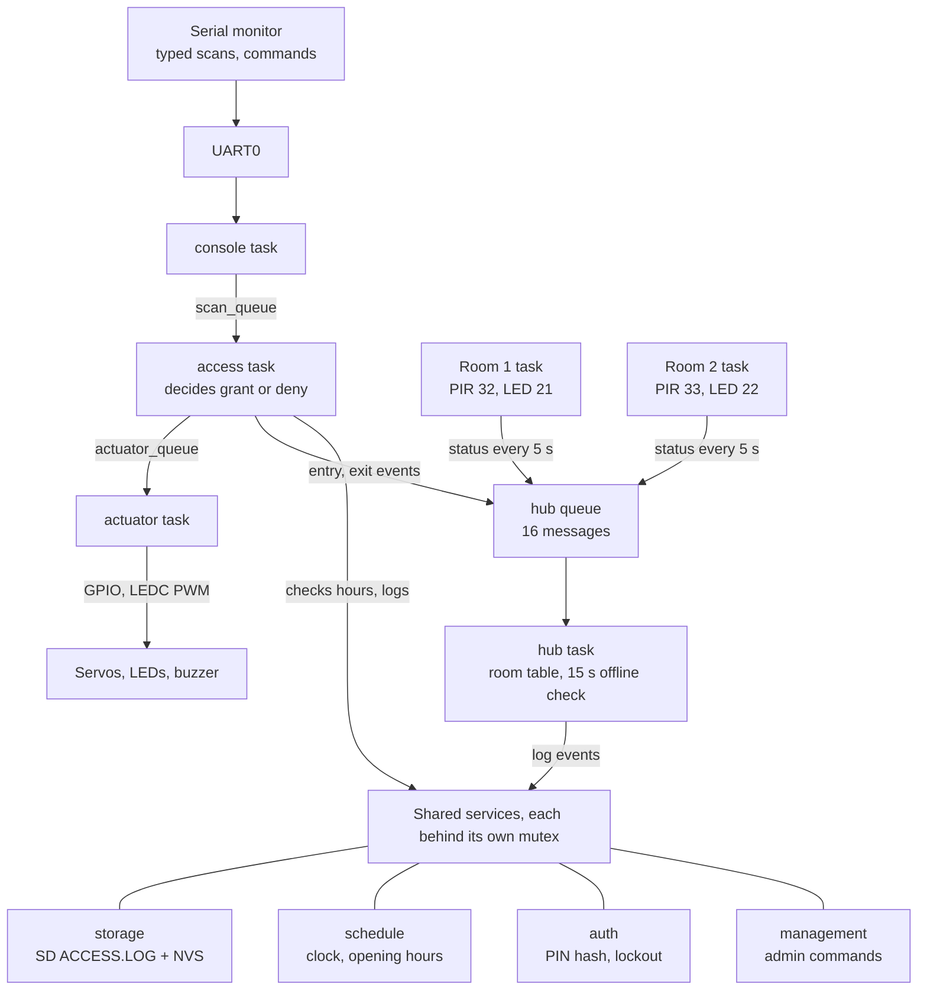

# CoCIS Smart Control and Monitoring System

## Group member details

| Name | Registration no. | Component owned |
|---|---|---|
| Mukyala Dorcus Nandy | 23/U/11911/EVE | Entrance: access control, doors, RFID simulation (`access_control`) |
| Mariam Wambui | 23/U/18494/PS | Lecture rooms: PIR occupancy and lighting (`room_control`) |
| Kisomose Arnold Patrick | 23/U/10079/EVE | Lecture rooms (`room_control`), project structure |
| Katumba Joshua Mugwanya | 23/U/09330/PS | Storage and SD log, schedule and clock, authentication, management commands |
| Nannyombi Shakiran | 23/U/11963/EVE | System integration: `main.c` and the hub task |

---

## 1. System operation

One ESP32 runs the whole system as FreeRTOS tasks: the building entrance, lecture room 1, and lecture room 2. The three “terminals” of the brief are separate tasks that talk through queues instead of separate boards. The firmware is written in C on ESP-IDF v5.5.1 and runs in the Wokwi simulator. It was also built and run on ESP-IDF v6.0.1.

### 1.1 Architecture

The firmware is split into seven ESP-IDF components, each owned by one or two members. `main.c` starts them in a fixed order: storage, schedule, auth, hub, management commands, room 1, room 2, entrance.

| Component | Role | Tasks it runs |
|---|---|---|
| `access_control` | Entrance: card decisions, doors, LEDs, buzzer, serial console | `access` (priority 5), `actuator` (4), `console` (3) |
| `room_control` | One instance per room: PIR occupancy and light control | `room1`, `room2` (5) |
| hub (in `cocis_system/main`) | Collects room reports and entrance events, detects offline rooms | `hub` (6) |
| `storage` | Settings in NVS flash; event log on the SD card plus a RAM copy | none |
| `schedule` | The single clock and the opening hours | none |
| `auth` | Admin PIN, login sessions, lockout | none |
| `management` | Admin commands added to the entrance console | none |

The brief describes three terminals: the entrance, room 1 and room 2. Here each terminal is a group of FreeRTOS tasks on the same ESP32, with its own pins, its own data and its own mutex, so it behaves like a separate unit.

### 1.2 How the three terminals communicate

How these three terminals communicate inside the one chip:

- **Entrance:** the console task turns each typed scan into a message on `scan_queue`. The access task decides and sends a door command on `actuator_queue`. The actuator task moves the servo and drives the LEDs and buzzer, so a 3-second door opening never blocks the next decision.
- **Rooms to hub:** each room task sends its status (occupied, light on, light-on time) on the hub queue whenever it changes, and as a heartbeat every 5 s.
- **Entrance to hub:** every entry or exit decision, granted or denied, is also sent to the hub. The hub announces occupancy. The entrance (`access_control`) is the single owner of the who-is-inside list; the `rooms` command reads `entrance_inside_count()` instead of keeping a second copy.
- **Offline detection:** if a room sends nothing for 15 s, the hub marks it OFFLINE and logs it; it returns to ONLINE on the next report.

**Figure 1.** Every terminal reports to the hub through one queue.

The entrance runs as a chain of three tasks on the left. Both rooms and the entrance feed the hub through one queue, and every task logs through the shared services.

A card scan is typed as `in A1B2C3D4` or `out A1B2C3D4`. The UID alone is not a command.

At boot the system is idle: both rooms EMPTY, lights off, doors closed, inside 0. Lights and servos move only after a PIR click or an `in` / `out` scan.

### 1.3 Hardware components and pin plan

All parts are wired to the one ESP32 DevKit C v4 in `diagram.json`.

| Part | Purpose | ESP32 pins |
|---|---|---|
| PIR motion sensor (room 1) | Detects motion in room 1 | GPIO 32 |
| Yellow LED + 330 Ω (room 1) | Room 1 lights | GPIO 21 |
| PIR motion sensor (room 2) | Detects motion in room 2 | GPIO 33 |
| Yellow LED + 330 Ω (room 2) | Room 2 lights | GPIO 22 |
| Servo (entry door) | Opens the entry door for 3 s | GPIO 18 (PWM, 50 Hz) |
| Servo (exit door) | Opens the exit door for 3 s | GPIO 19 (PWM, 50 Hz) |
| Green LED + 220 Ω | Access granted | GPIO 25 |
| Red LED + 220 Ω | Access denied | GPIO 26 |
| Buzzer | Deny tone (2 kHz) | GPIO 27 |
| microSD card (SPI) | Log file `ACCESS.LOG` | SCK 14, MOSI 13, MISO 34, CS 4 |
| Serial monitor (UART0, 115200 baud) | Card scans and admin menu | TX / RX |

Wokwi has no RFID reader part, so a card scan is typed at the serial monitor: `in A1B2C3D4` at the entry reader, `out A1B2C3D4` at the exit reader. A real MFRC522 reader task would put the same message on `scan_queue`, and the decision code would not change.

### 1.4 Software design

**Entrance decision.** For each scan the access task checks, in this order:

1. Is the card registered? If not: unknown tag.
2. Is it blocked (lost or stolen)? If so: tag blocked.
3. Entry only: is the person already inside? If so: already inside (anti-passback).
4. Exit only: is the person inside? If not: not inside.
5. Is the building open now? If not, entry is denied, and exit is denied unless emergency mode is on (outside access hours or emergency exit).

A granted decision updates the “who is inside” record, opens the matching door for 3 s and lights the green LED. A denied one lights the red LED and sounds the buzzer. Every decision is printed and written to the system log.

**Room control.** Each room task polls its PIR every 100 ms. Motion switches the light on at once. The light goes off 10 s after the last motion (a demo value; about 5 minutes in real use), because a PIR sees movement, not presence. Each room also adds up how long its light has been on.

**Schedule and clock.** One simulated clock starts at 08:00 at boot. The default opening hours are 08:00–18:00. Opening time must be before closing time. The hours are saved in NVS, so they survive a reset.

**Storage and logging.** At boot the SD card is mounted over SPI and every event is appended to `/sdcard/ACCESS.LOG` as `seq,HH:MM:SS,EVENT,details`. The last 20 lines are also kept in RAM. If the card cannot be mounted, or a write fails, the system keeps running in RAM-only mode and says so at boot. Logged events include card decisions, room changes, rooms going offline, logins, schedule and clock changes, emergency mode and card blocking.

**Authentication.** Changing any setting needs an admin login. The PIN is never stored in plain text: NVS holds a random 16-byte salt and the SHA-256 hash of salt + PIN, compared in constant time. Three wrong PINs lock login for 30 s. A session ends after 120 s without a protected command. The default PIN `1234` is created on first boot and the system warns until it is changed. The PIN is never printed or logged, and the console shows `****` while it is typed.

### 1.5 Synchronisation

Every shared record has one owner and one lock, so two tasks never update it at the same time.

| Shared data | Protected by | Used by |
|---|---|---|
| Card table, inside flags, inside count, entrance log | `state_mutex` | access task, console commands |
| Each room’s status | the room’s own mutex | room task, hub |
| Hub room table (online / last report) | hub mutex | hub task, `rooms` command |
| Building occupancy | `state_mutex` in access_control (single owner) | entrance, `rooms` |
| Clock and opening hours | schedule mutex | entrance, management commands |
| Log ring and SD file | storage mutex | every component that logs |
| Login session and lockout | auth mutex | management commands |

Tasks pass work through queues instead of calling each other: `scan_queue` and `actuator_queue` at the entrance, and the hub queue for room and entrance events. The callbacks that feed the hub only enqueue a message with no wait, so a slow hub can never stall a room or the entrance.

### 1.6 Implemented features and serial menu

All commands are typed in the Wokwi serial monitor. Viewing needs no login; changing a setting does.

| Command | What it does | Login |
|---|---|---|
| `in <UID>` / `out <UID>` | Simulated card scan at the entry or exit reader | no |
| `inside` | Who is inside and how many | no |
| `log` | Recent entrance decisions | no |
| `status` | Clock, hours, open or closed, emergency mode, people inside | no |
| `rooms` | Each room: online or offline, occupied or empty, light on or off, light-on time; building occupancy | no |
| `users` | Registered cards and their state | no |
| `hours` / `clock` | Show opening hours / show the clock | no |
| `login <pin>` / `logout` | Start or end an admin session | no |
| `setpin <new>` | Change the admin PIN (4–8 digits) | yes |
| `hours HH:MM HH:MM` | Set opening hours | yes |
| `clock HH:MM` | Set the simulated clock | yes |
| `syslog [n]` | Last n system log lines from RAM and the SD card | yes |
| `emergency on\|off` | Allow exit outside opening hours | yes |
| `block <UID>` / `unblock <UID>` | Block or unblock a lost or stolen card (saved in NVS) | yes |
| `roomfail <n> on\|off` | Test aid: make a room stop reporting, to show offline detection | yes |
| `help` | List all commands | no |

Registered cards are fixed in the firmware: Alice (Staff) `A1B2C3D4`, Brian (Student) `B2C3D4E5`, Carol (Student) `C3D4E5F6`, Dan (Admin) `D4E5F6A7`, and a lost card `DEADBEEF` that starts blocked.

### 1.7 Requirements coverage

| Brief | How the system meets it |
|---|---|
| 2.1 Entry and exit control | Two scan points, registered cards, anti-passback, “who is inside” record |
| 2.2 Room occupancy and lighting | PIR per room; light on with motion, off 10 s after the last motion |
| 2.3 Terminals communicate | Room and entrance tasks report to the hub over a queue; offline detection |
| 2.4 SD card storage | Access decisions, occupancy changes and system activity appended to `ACCESS.LOG` |
| 2.5 Serial menus | `inside`, `log`, `rooms`, `status`, `syslog` |
| 2.6 Schedule and authorised changes | Exit and entry denied outside hours; only a logged-in admin can change hours, clock or emergency mode |
| 2.7 Synchronisation | One mutex per shared record, one owner for occupancy, queues between tasks (section 1.5) |

---

## 2. Wokwi simulation link

**Source code:** https://github.com/MukyalaDorcusNandy/cocis-smart-system  
**Integration pull request:** https://github.com/MukyalaDorcusNandy/cocis-smart-system/pull/6  

The Wokwi circuit is in the repository: `cocis_system/diagram.json` and `cocis_system/wokwi.toml`. Start the simulator from that project; there is no separate public Wokwi URL.

To run it locally in VS Code: build the `cocis_system` project with ESP-IDF (`idf.py build`), then press F1 and choose **Wokwi: Start Simulator**. Click inside the Wokwi terminal to type commands; `help` lists them. A quick demonstration:

1. `in A1B2C3D4`: Alice enters, the green LED lights and the entry servo opens.
2. Click PIR 1: room 1 lights up and the hub prints `[HUB] room 1 OCCUPIED, light ON`.
3. `login 1234`, then `clock 19:00`: the building is now closed.
4. `out A1B2C3D4`: exit is denied outside hours. `emergency on`, then `out A1B2C3D4` again: exit is granted.
5. `syslog 10`: the same events, read back from the SD card.

Boot in Wokwi was checked against this report. The serial output matches section 1: NVS and SD log up, hours 08:00–18:00, both rooms ONLINE and EMPTY with lights off, entrance ready, inside 0.

---

## 3. Individual video demonstrations

Each member recorded their screen while explaining the code they wrote and showing it running in Wokwi.

| Member | Video link | What the video shows |
|---|---|---|
| Mukyala Dorcus Nandy | [paste link] | `access_control.c`: the decision rules, the scan, door and console tasks and their queues; demo of granted and denied scans, anti-passback, LEDs, buzzer and servos |
| Mariam Wambui | [paste link] | `room_control.c`: PIR polling, the vacancy timer and light control. Demo with PIR 1 and PIR 2 |
| Kisomose Arnold Patrick | [paste link] | `room_control` as one reusable component for both rooms, `room_config.h` pin plan, the single-ESP32 project layout. Demo of both rooms running together |
| Katumba Joshua Mugwanya | [paste link] | storage, schedule, auth, management: SD log, opening hours, PIN hashing and lockout. Demo of `login`, `hours`, `clock`, `emergency` and `syslog` |
| Nannyombi Shakiran | [paste link] | `main.c` start-up order and `hub.c`: the hub queue, occupancy ownership and offline detection. Demo of `rooms` and `roomfail` |

---

## 4. Individual contributions

Each member owned one part of the system, developed it on their own branch and merged it through a pull request. The parts were then brought together and tested as one firmware on the `integrate` branch. That branch was reviewed and opened as a pull request to `main`.

**Mukyala Dorcus Nandy: entrance and access control**

- Designed the entrance as three tasks (console, access, actuator) joined by `scan_queue` and `actuator_queue`.
- Wrote the access decision: registered card, blocked card, anti-passback, opening hours and emergency exit.
- Drove the hardware: entry and exit servos (LEDC PWM), green and red LEDs, buzzer.
- Built the serial console with simulated RFID (`in` / `out`), character echo, PIN masking, and the command table other components register into.
- Kept the “who is inside” record and the entrance log; added card blocking saved in NVS.
- Added the entrance parts to `diagram.json` and wrote the first README.

**Mariam Wambui: lecture-room occupancy and lighting**

- Wrote the room task: PIR polling every 100 ms, light on with motion, off after the vacancy delay.
- Added light-on time tracking and the room status record (occupied, light on, light-on seconds).
- Wired and tested both PIR sensors and room LEDs in Wokwi.
- Updated the application start-up (`app_main`) to run the rooms.

**Kisomose Arnold Patrick: room component and project structure**

- Made `room_control` one reusable component that runs room 1 and room 2 in the same firmware, each with its own pins, task and mutex.
- Wrote `room_config.h` (pin plan, poll interval, vacancy delay, heartbeat) and the status callback that reports each room to the rest of the system.
- Set up the single-ESP32 project (`cocis_system`) and the shared `components/` layout.
- Maintained the repository: `.gitignore`, removal of the old per-node folders, and `PROJECT_STRUCTURE.md`.

**Katumba Joshua Mugwanya: storage, schedule, authentication and management**

- **storage:** NVS settings, SD card mounting over SPI, the `ACCESS.LOG` file, the RAM log and the RAM-only fallback.
- **schedule:** the single simulated clock, opening hours saved in NVS, and the shared `schedule_log` used by every component.
- **auth:** salted SHA-256 PIN storage, constant-time comparison, 3-try lockout, 120 s idle timeout, first-boot default PIN.
- **management:** the admin commands `login`, `logout`, `setpin`, `hours`, `clock`, `syslog`, `emergency`, `block`, `unblock`.

**Nannyombi Shakiran: system integration and hub**

- Owned `cocis_system/main/main.c`: the start-up order of all components and error checks on each.
- Owned the hub (`hub.c`, `hub.h`): one queue for room reports and entrance events, 15 s offline detection.
- Added the `rooms` command (room occupancy and lighting) and the `roomfail` test command.
- Kept building occupancy with the entrance (one owner) so the hub does not store a second count.
- Checked the `integrate` branch, opened the pull request to `main`, and finalised this report.

**Shared work:** all members agreed the pin plan and command names, reviewed each other’s pull requests, and wrote this report together.

---

## 5. Testing and limitations

The firmware builds with no errors or warnings on ESP-IDF v5.5.1. It was also built and run on ESP-IDF v6.0.1. It was tested in Wokwi with the test steps in `docs/TEST_PLAN.md`, covering boot, card scans, opening hours, rooms, offline detection, login security and the SD log.

Boot was verified in Wokwi: `[STORAGE] settings in NVS: OK`, SD log mounted, `[SCHEDULE] open 08:00, close 18:00`, both rooms `ONLINE` and `EMPTY, light OFF`, entrance ready, `inside 0`.

**Limitations**

- RFID is simulated by typing the card ID, because Wokwi has no RFID reader part.
- Registered cards are fixed in the firmware; adding a card means rebuilding.
- A PIR detects movement, not people, so rooms show occupied or empty but not who or how many.
- The “who is inside” record is kept in RAM and is reset by a reboot. Blocked cards and settings are kept in NVS.
- The clock is simulated and starts at 08:00 at every boot.
- There is one admin role with one PIN.
